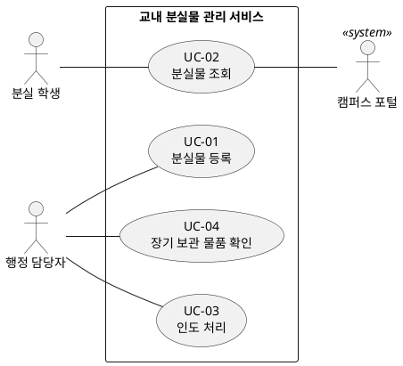

# 요구사항 명세 — 교내 분실물 관리 서비스

- 기준 자료: [고객 요구사항](고객 요구사항.md)의 NEEDS_1~NEEDS_7, SC1~SC8, C_1
- 상태: 수업용 예시 명세 (v1.1, 2026-11-26). 설계 실습(UC-01~UC-03)에 TDD 실습용 UC-04·BR-08을 더했다.

> **구분:** `고객 근거`는 고객 요구사항 문서에서 온 내용이다. `수업용 가정`은 실습을 진행하기 위해 강사가 정한 조건이며 실제 고객 합의가 아니다. `[논의]`는 아직 정하지 않은 사항이다.

## 1. 시스템 개요

1. 분실물 관리 서비스는 행정 담당자와 분실 학생이 이용하는 프로그램이다.
2. 행정 담당자는 습득한 물품의 물품명, 분류, 습득일, 보관 장소를 입력하여 분실물을 등록한다.
3. 시스템은 등록한 분실물에 물품 번호를 부여하고 상태를 ‘보관 중’으로 기록한다.
4. 분실 학생은 물품명이나 분류로 분실물을 검색하여 보관 여부와 보관 장소, 담당 부서의 문의 방법을 확인한다.
5. 캠퍼스 포털은 보관 중인 분실물의 물품명, 분류, 보관 장소를 가져가 게시한다. (수업용 가정 BR-07)
6. 행정 담당자는 주인 확인을 마친 분실물을 인도 처리하며, 시스템은 상태를 ‘인도 완료’로 바꾸고 인도일을 기록한다.
7. 행정 담당자는 기준일을 정해, 습득일로부터 30일이 넘게 보관 중인 분실물을 확인한다. (수업용 가정 BR-08)

## 2. 액터와 유스케이스

|액터|역할|
|---|---|
|분실 학생|잃어버린 물건의 보관 여부·보관 장소·문의 방법을 확인한다.|
|행정 담당자|습득물을 등록하고 주인에게 인도한 결과를 기록한다.|
|캠퍼스 포털 (외부 시스템)|조회 API로 보관 중인 분실물 목록을 가져가 포털에 게시한다. 사람이 아닌 액터다(수업용 가정 BR-07).|

습득 학생·학생회·정보보호 담당자는 이해관계자이지만 이번 범위에서 시스템을 직접 조작하지 않으므로 액터로 두지 않는다. 습득물 접수 장소 안내(SC4)는 미정이다.

|UC ID|UC 이름|액터|사용자 목표|근거|
|---|---|---|---|---|
|UC-01|분실물 등록|행정 담당자|습득물을 조회할 수 있도록 물품 정보를 기록한다.|NEEDS_2, SC2|
|UC-02|분실물 조회|분실 학생, 캠퍼스 포털|방문 전에 보관 여부·보관 장소·문의 방법을 확인한다.|NEEDS_1, NEEDS_4, SC1, SC6|
|UC-03|인도 처리|행정 담당자|주인에게 돌려준 물품을 ‘인도 완료’로 기록해 보관 중인 물품과 구분한다.|NEEDS_3, SC3|
|UC-04|장기 보관 물품 확인|행정 담당자|30일이 넘게 보관 중인 물품을 찾아 후속 처리 대상을 정한다.|수업용 가정 (BR-08)|

## 3. 공통 업무 규칙

|규칙 ID|내용|구분|
|---|---|---|
|BR-01|분실물의 상태는 `보관 중`, `인도 완료` 두 가지다.|고객 근거(S2·SC3)|
|BR-02|등록 시 상태는 `보관 중`이다.|수업용 가정|
|BR-03|인도 처리는 `보관 중`이고 주인 확인을 마친 분실물만 가능하다.|수업용 가정|
|BR-04|잘못된 요청은 기존 분실물 기록을 바꾸지 않는다.|수업용 가정|
|BR-05|조회 화면에 개인 휴대전화 번호를 표시하지 않는다. 담당 부서와 문의 방법을 표시한다.|고객 근거(S4·S5·SC6·SC8)|
|BR-06|가상 데이터만 사용하며 실제 개인정보·학교 인증 연동은 제외한다.|고객 근거(C_1)|
|BR-07|캠퍼스 포털은 조회 API로 UC-02와 같은 공개 항목(BR-05)만 가져간다. 학생 인증·개인정보는 주고받지 않으며, 결과가 없으면 빈 목록을 돌려준다.|수업용 가정|
|BR-08|보관 기간은 기준일에서 습득일을 뺀 일수다. 보관 기간이 **30일을 초과**한 `보관 중` 분실물만 장기 보관 물품이다. 보관 기간이 딱 30일인 분실물과 `인도 완료` 분실물은 장기 보관 물품이 아니다.|수업용 가정|

## 4. 유스케이스 기술서

### UC-01 — 분실물 등록 (초안)

|항목|내용|
|---|---|
|목표|행정 담당자가 습득물 정보를 기록해 학생이 조회할 수 있게 한다.|
|액터|행정 담당자|
|근거|NEEDS_2, NEEDS_7, SC2, BR-02, BR-04|
|사전조건|프로그램이 실행 중이며 보관 장소 목록이 준비되어 있다.|
|시작 사건|담당자가 분실물 등록을 요청한다.|
|성공 후 결과|새 분실물이 물품 번호와 `보관 중` 상태로 기록된다.|
|실패·중단 후 결과|새 분실물을 추가하지 않고 기존 기록을 유지한다. 문제를 안내한다.|
|미확정 사항|[논의] Q-L01 — 등록 필수 항목(물품명·분류·습득일·보관 장소 외 사진·특징 포함 여부). [논의] Q-L02 — 등록 부담을 줄이는 방법과 측정 기준.|

|단계|액터의 행동|시스템의 응답|
|---|---|---|
|1|물품명·분류·습득일·보관 장소를 입력하고 등록을 요청한다.|입력값을 받는다.|
|2|—|필수 항목과 습득일이 올바른지 확인한다.|
|3|—|물품 번호를 부여하고 `보관 중` 상태로 분실물을 기록한다.|
|4|등록 결과를 확인한다.|물품 번호와 등록 완료를 안내한다.|

|흐름|분기 단계·조건|응답|처리 후 결과|
|---|---|---|---|
|E1·예외|2단계: 필수 항목이 비었거나 습득일이 잘못된 경우|문제 항목을 안내한다.|등록하지 않고 1단계로 돌아간다. 기존 기록은 그대로다.|

### UC-02 — 분실물 조회 (초안)

|항목|내용|
|---|---|
|목표|분실 학생이 방문 전에 물품의 보관 여부·보관 장소·문의 방법을 확인한다.|
|액터|분실 학생 (화면), 캠퍼스 포털 (조회 API, 수업용 가정 BR-07)|
|근거|NEEDS_1, NEEDS_4, NEEDS_6, SC1, SC6, BR-05, BR-07|
|사전조건|프로그램이 실행 중이다. 등록된 분실물이 없어도 시작할 수 있다.|
|시작 사건|학생이 물품명 또는 분류로 검색을 요청한다.|
|성공 후 결과|검색어에 맞는 분실물의 물품명·분류·상태·보관 장소·담당 부서·문의 방법을 확인한다. 조회로 기록은 바뀌지 않는다.|
|실패·중단 후 결과|별도 실패 조건은 정하지 않았다. 결과가 없으면 없음을 안내한다(A1).|
|미확정 사항|[논의] Q-L03 — `인도 완료` 물품도 검색 결과에 보여 줄지. [논의] Q-L04 — 검색 조건(물품명·분류 외 습득일 등).|

|단계|액터의 행동|시스템의 응답|
|---|---|---|
|1|검색어(물품명 또는 분류)를 입력한다.|입력값을 받는다.|
|2|—|검색어와 일치하는 분실물을 찾는다.|
|3|결과를 확인한다.|분실물별 상태·보관 장소·담당 부서·문의 방법을 보여 준다.|

|흐름|분기 단계·조건|응답|처리 후 결과|
|---|---|---|---|
|A1·대안|2단계: 일치하는 분실물이 없는 경우|검색 결과가 없음을 안내하고 담당 부서 문의 방법을 보여 준다.|종료. 기록은 그대로다.|

### UC-03 — 인도 처리 (상세, 시퀀스 다이어그램 실습 대상)

|항목|내용|
|---|---|
|목표|행정 담당자가 주인에게 돌려준 물품을 `인도 완료`로 기록해 보관 중인 물품과 구분한다.|
|액터|행정 담당자|
|근거|NEEDS_3, SC3, BR-01, BR-03, BR-04|
|사전조건|프로그램이 실행 중이다. 담당자가 물품 주인을 대면으로 확인할 수 있다(수업용 가정).|
|시작 사건|담당자가 물품 번호와 주인 확인 결과를 입력하고 인도 처리를 요청한다.|
|성공 후 결과|대상 분실물의 상태가 `인도 완료`가 되고 인도일이 기록된다. 다른 분실물은 바뀌지 않는다.|
|실패·중단 후 결과|대상과 다른 분실물의 상태·인도일이 모두 그대로다. 인도할 수 없는 이유를 안내한다.|
|미확정 사항|[논의] Q-L05 — 잘못 인도 처리한 기록의 정정 방법(C5와 같은 성격의 후속 기능 여부). [논의] Q-L06 — 여러 오류가 겹칠 때 안내 순서.|

|단계|액터의 행동|시스템의 응답|
|---|---|---|
|1|물품 번호와 주인 확인 결과를 입력하고 인도 처리를 요청한다.|입력값을 받는다.|
|2|—|물품 번호로 분실물을 찾는다.|
|3|—|분실물이 `보관 중`이고 주인 확인을 마쳤는지 확인한다.|
|4|—|상태를 `인도 완료`로 바꾸고 인도일을 기록한다.|
|5|결과를 확인한다.|인도 완료 결과를 안내한다.|

|흐름|분기 단계·조건|응답|처리 후 결과|
|---|---|---|---|
|E1·예외|2단계: 등록되지 않은 물품 번호|‘등록되지 않은 물품’임을 안내한다.|종료. 모든 기록이 그대로다.|
|E2·예외|3단계: 이미 `인도 완료`인 분실물|이미 인도된 물품이라 처리할 수 없음을 안내한다.|종료. 상태·인도일이 그대로다.|
|E3·예외|3단계: 주인 확인을 마치지 않은 경우|주인 확인이 필요함을 안내한다.|종료. 상태가 `보관 중`으로 유지된다.|

### UC-04 — 장기 보관 물품 확인 (TDD 실습 대상)

|항목|내용|
|---|---|
|목표|행정 담당자가 30일이 넘게 보관 중인 분실물을 확인해 후속 처리 대상을 정한다.|
|액터|행정 담당자|
|근거|BR-01, BR-08 (수업용 가정)|
|사전조건|프로그램이 실행 중이다. 등록된 분실물이 없어도 시작할 수 있다.|
|시작 사건|담당자가 기준일(보통 오늘 날짜)을 정하고 장기 보관 물품 확인을 요청한다.|
|성공 후 결과|장기 보관 물품(BR-08)의 물품 번호를 등록 순서대로 확인한다. 확인으로 기록은 바뀌지 않는다.|
|실패·중단 후 결과|별도 실패 조건은 정하지 않았다. 대상이 없으면 빈 목록이다(A1).|
|미확정 사항|[논의] Q-L07 — 장기 보관 물품의 처리 방법(폐기·기증 등)과 처리 기능은 이번 범위가 아니다. [논의] Q-L08 — 기준일·습득일 형식이 잘못된 경우의 처리.|

|단계|액터의 행동|시스템의 응답|
|---|---|---|
|1|기준일을 정하고 장기 보관 물품 확인을 요청한다.|기준일을 받는다.|
|2|—|`보관 중`인 분실물마다 보관 기간(기준일 − 습득일)을 계산한다.|
|3|—|보관 기간이 30일을 초과한 분실물만 고른다(BR-08).|
|4|결과를 확인한다.|고른 분실물의 물품 번호를 등록 순서대로 보여 준다.|

|흐름|분기 단계·조건|응답|처리 후 결과|
|---|---|---|---|
|A1·대안|3단계: 장기 보관 물품이 없는 경우|빈 목록을 돌려준다.|종료. 기록은 그대로다.|

## 5. 변경 이력

|버전|날짜|내용|
|---|---|---|
|v1.0|2026-11-12|UC-01~UC-03, BR-01~BR-07 (설계 실습 입력)|
|v1.1|2026-11-26|UC-04 장기 보관 물품 확인, BR-08 추가 (TDD 실습 입력)|
